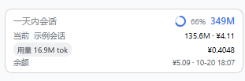
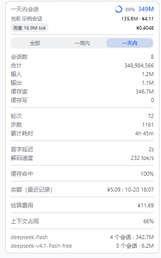
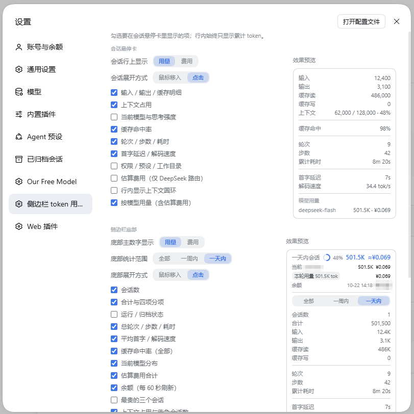
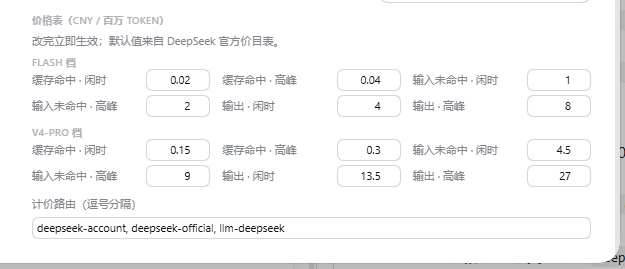

# dsh-sidebar-token-usage

DSH Web GUI 侧边栏 token 用量插件。

> **使用说明见 [使用说明.md](./使用说明.md)** —— 安装、全部设置项、数据口径、已知问题。
> 本文档偏开发向：包结构、槽位契约、自测。

- **会话行内常驻**：`sidebar.session.row.leading` 显示该会话累计 token 总量（`1.2K` / `345K` / `1.2M`），蓝色圆角胶囊。
- **会话行悬停卡**：`sidebar.session.row.hover` 展开输入 / 输出 / 缓存读 / 缓存写 / 上下文占用，并按模型列出各自用量。
- **侧边栏底部**：`sidebar.footer.action` 显示全部会话合计总量（显示用量时并在其后给出该范围的 `≈¥` 估算费用，与用量同样蓝色加粗），收起时再带当前会话（标题 + 用量）、最新一轮（Turn）的「本轮用量 X tok」胶囊、每 60 秒探测的账号余额；所有价格都放在最右一列右对齐，余额价格加粗放大，且收起/展开时都留在第四行（展开明细里不再重复）；点胶囊在 `shell.overlay` 弹出本轮明细（提供方/模型、缓存命中、四项 bucket），按设置鼠标移入或点击展开会话数与分项合计；侧边栏折叠（56px 轨道）时自动切换为紧凑态。

## 示例

> 以下均为实拍图。

### 会话行胶囊与浮层明细


### 侧边栏底部：收起态



### 侧边栏底部：展开明细



### 设置页：选项与实时预览



### 设置页：价格表



## 数据来源

合计数据只读内存中的客户端投影，不轮询、不在启动时建索引：

- `ctx.sessions.list.getSnapshot()` → `{ ids, byId }`
- `byId[id].projectionValues.tokenUsage` → `{ uncachedInputTokens, outputTokens, cacheReadTokens, cacheWriteTokens }`
- `byId[id].projectionValues.contextPressure` → `{ pressureTokens?, projectedTokens?, contextWindow? }`

会话总量 = 四个 bucket 之和。上下文占用优先 `pressureTokens`，缺失时退回 `projectedTokens`，分母 `contextWindow`。

投影缺失（例如仅来自持久检查点缓存、数值未加载）时显示占位符 `—`，不隐藏整行、不抛错；全零的投影是真实数值，显示 `0`。

## 按模型用量与最新一轮

`tokenUsage` 投影只有整条会话的合计，没有模型维度，也没有单轮的用量，两者都由宿主半边按需提供：

- 路由：`GET /api/sidebar-token-usage/models?session=<id>`、`GET /api/sidebar-token-usage/latest?session=<id>`（均 `kind: exact`）
- 触发时机：按模型**只有悬停卡/浮层打开时**才请求；最新一轮只针对当前会话，切走、用量变化或运行状态变化时重读
- 实现：`ctx.sessionQuery.readSession(id)` 折 `assistant/message` 的 `message.source.{provider,model}` 与 `data.usage`；
  最新一轮以最后一个 `turn/end` 定位，把该轮全部结算加总并按路由拆分，与聊天里的「本轮用量」同口径
- 缓存：两份结果共用进程内 30 秒 TTL（最多 64 条会话）；`latest` 强制新鲜读，一轮结束后立即反映
- 客户端先试绝对路径 `/api/...`，失败再退回文档相对路径，首次成功后固定该形式

## 两种呈现形态

| 形态 | 槽位 | 开关 | 说明 |
| --- | --- | --- | --- |
| 上下文圆环 | 行内 / 底部 | `行内显示上下文圆环`、`底部显示上下文圆环` | SVG 径向进度，占用 ≥80% 时转为告警色 |
| 点击浮层 | `shell.overlay` | 始终可用 | 点行内胶囊弹出卡片，复用悬停卡的同一套分组 |

圆环的颜色来自 CSS 变量（`--dsw-alias-state-business-primary` / `--dsw-alias-state-error-primary`），
不写死色值，深浅主题自动跟随。

### 设置项与预览同排

设置页按作用域分两块（会话悬停卡 / 侧边栏底部），每块是**左选项、右预览**的两列布局：

```
会话悬停卡
  左：会话行显示 [用量|费用] + 各分组勾选     右：悬停卡预览
侧边栏底部
  左：主数字 [用量|费用] + 范围 [全部|周|日] + 各分组勾选   右：底部卡片预览
```

预览渲染的是 **RowHover / FooterCard 本体**，喂一份固定示例数据（1 条会话：12.4K 输入 / 3.1K 输出 /
486K 缓存读 / 48% 上下文 / 9 轮 42 步 / deepseek-flash）。因此预览与真实效果天然一致，
在预览的底部卡片上点范围标签也会真的写进设置。窄屏（≤720px）自动落成单列。

## 显示内容选择（设置页）

设置页有「显示内容」一节，五个单选（胶囊式分段控件），改动即时生效并持久化：

| 选项 | 取值 | 默认 | 作用 |
| --- | --- | --- | --- |
| 会话行上显示 | 用量 / 费用 | 用量 | 行内胶囊显示 token 还是估算 CNY |
| 会话展开方式 | 鼠标移入 / 点击 | 鼠标移入 | 会话明细由悬停卡还是点击浮层展开 |
| 底部主数字显示 | 用量 / 费用 | 用量 | 底部卡片那行主数字 |
| 底部统计范围 | 全部 / 一周内 / 一天内 | 全部 | 底部聚合的时间窗口，收起时的标签也跟着变 |
| 底部展开方式 | 鼠标移入 / 点击 | 鼠标移入 | 底部卡片明细的展开触发方式 |

**范围标签页与设置里的分段控件是同一个设置**：点悬停卡上的标签会写进配置，反过来改配置也会让标签跳过去。
选择费用时，若该会话的路由不在计价白名单里，行内显示 `—` 而不是伪装成 0。

**展开方式**只改触发，不改内容：选「点击」后，底部卡片点主行开合（`data-open` 驱动的 CSS 开合）；
会话行不再往悬停卡里渲染明细，改为点胶囊打开 `shell.overlay` 浮层，同时跳过宿主模型请求。
设置页的两个预览不受该设置影响，始终展示展开后的样子。

## 悬停卡显示项（设置页）

侧边栏 **设置 → 侧边栏 token 用量** 里有一组勾选项，决定悬停卡显示哪些分组：

| 勾选项 | 内容 | 默认 |
| --- | --- | --- |
| 输入 / 输出 / 缓存明细 | 四项 bucket 数值 | 开 |
| 上下文占用 | `used / window · %` | 开 |
| 当前模型与思考强度 | `modelSelection.lastUsed` | 开 |
| 按模型用量 | 宿主路由按需折日志 | 开 |
| 缓存命中率 | cacheRead / prompt 侧合计 | 关 |
| 轮次 / 步数 / 耗时 | `sessionStats` | 关 |
| 首字延迟 / 解码速度 | `sessionStats` | 关 |
| 权限 / 预设 / 工作目录 | `permissions`、`agentPreset`、`cwd` | 关 |

**侧边栏底部卡片**同页第二组勾选项：

| 勾选项 | 内容 | 默认 |
| --- | --- | --- |
| 会话数 | 列表内会话总数 | 开 |
| 合计与四项分项 | 全部会话 token 合计 + 四个 bucket | 开 |
| 运行 / 归档状态 | 运行中、已归档各多少条 | 关 |
| 总轮次 / 步数 / 耗时 | `sessionStats` 求和 | 关 |
| 平均首字 / 解码速度 | 由 `ttftMs`、`decodeTokens` 求均值 | 关 |
| 缓存命中率（全部） | cacheRead / prompt 侧合计 | 关 |
| 当前模型分布 | 每个模型涉及多少会话、各自 token | 关 |
| 最贵的三个会话 | 按估算费用排序，会话标题 + ¥ | 关 |
| 上下文占用与告急会话数 | 最高占用率 + 占用 ≥80% 的会话数 | 关 |
| 均每会话用量与输出占比 | 合计 / 会话数，以及输出 token 占合计的比例 | 关 |
| 活动时间跨度 | 窗口内最早 ~ 最新的活动时间 | 关 |
| Agent 预设与权限分布 | 各预设/权限档位的会话数（最多列前三） | 关 |

## 估算费用

### 价格表可编辑

设置页底部是价格表编辑器，12 个数字框（flash / v4-pro 两行 × 缓存命中/输入未命中/输出 三列 × 闲时/高峰 两档），
外加一个「计价路由」文本框（逗号分隔）。默认值就是 DeepSeek 官方价目表，改动即时生效并持久化到
`localStorage` 的 `dsh-sidebar-token-usage:prices`。

改价之后所有费用显示（会话悬停、按模型、底部合计）立刻按新价重算。

### 余额

底部卡片显示**登录账号的 Platform 钱包余额**，每 60 秒探测一次：

- 宿主从 `@deepseek-ai/dsh-credentials` 读取浏览器登录留下的 grant
  （`deepseek-account-platform/default`），请求
  `GET https://platform.deepseek.com/api/v0/users/get_user_summary`，
  读取 `normal_wallets` + `bonus_wallets`（同币种相加）。这是 DSH 账号页用的同一套接口，
  不需要 API Key
- 宿主侧缓存 60 秒；页面每 60 秒拉一次 `/api/sidebar-token-usage/balance`
- 探测失败（grant 过期、断网、协议变化）时退回 `~/.dsh/.dshw-usage.json` 的旧记录，
  悬停提示会标注「旧记录」
- grant 只在宿主进程内使用，不下发到浏览器；过期后需重新登录 DeepSeek 账号

开关项：`余额（每 60 秒刷新）`，默认开。


只有**有价格信息的路由**才显示费用，其余完全不显示（不显示 0，也不显示占位符）。

- 计价表：DeepSeek 官方各行，CNY / 百万 token，区分高峰与空闲两档
  - flash 档：缓存命中 `0.02 / 0.04`，输入未命中 `1 / 2`，输出 `4 / 8`
  - v4-pro 档：缓存命中 `0.15 / 0.3`，输入未命中 `4.5 / 9`，输出 `13.5 / 27`
  - 高峰时段：北京时间工作日 09:00–12:00、14:00–18:00
  - `v4-pro` 在 2026-09-14 12:00 (+08:00) 之后并入 flash 档计费
- 计费口径：`(缓存读×cacheHit + (输入+cache写)×inputMiss + 输出×output) / 1e6`
- **只对有价格表的路由计价**（`deepseek-account`、`deepseek-official`、`llm-deepseek`）；
  `our-free-model` 这类免费/第三方路由不出价
- 会话级费用按该会话 `modelSelection.lastUsed` 的路由估算；一个会话若中途换过模型，
  这个数是近似值（按模型用量那一栏则是逐模型精确的）
- **未建模中国法定节假日**，节假日的工作日会按高峰价算，也就是估算偏高而非偏低

显示位置：会话悬停卡「估算费用」一行、按模型那一栏每行尾部的 `· ¥x`、底部卡片合计。
三项都有独立开关。

### 范围标签页

底部卡片悬停后顶部有三个范围标签：**全部 / 一周内 / 一天内**。

口径说明：投影里只有每条会话的累计值，没有按天的消耗明细，所以标签按
**会话最后一次活动时间**（行数据里的 `updatedAt`）筛选会话，再对这些会话的累计值求和。
即「一周内」= 最近 7 天有过活动的那些会话，而不是「过去 7 天消耗掉的 token」。

要得到真正的按天消耗，必须扫描全部会话日志并按事件时间切分——那是另一个量级的开销，本插件不做。

选择存在浏览器 `localStorage`（键 `dsh-sidebar-token-usage:fields`），逐浏览器生效；范围标签记在本次页面会话内。
**会话行内徽标不受配置影响**，始终显示累计 token。

## 包结构

```
package.json        # type=module, main=lib/index.js, exports "." 与 "./client", dsh.bundle/client
cordis.patch.yml    # 顶层数组，插入 id: sidebar-token-usage 的插件行
lib/index.js        # 宿主半边：按需读取单条会话日志，提供按模型用量路由
lib/client.js       # 浏览器半边：Module Loader 工厂格式，只 require("react")
scripts/selfcheck.cjs
```

浏览器半边必须由 Module Loader 以 `window.__ModuleLoader__.load({ id, factory })` 装载，因此 `lib/client.js`
是脚本而不是 ESM 模块；`node --check` 不适用，语法与契约由 `scripts/selfcheck.cjs` 校验。

## 主题与语言

样式只通过 DSH CSS 变量（`--dsw-alias-label-*`、`--dsw-alias-border-l4`、`--dsw-alias-button-elevated-fill`、
`--dsw-radius-*`）取色，无硬编码颜色，浅色 / 深色主题自动跟随。文案走 `ctx.locale.register` 的
`sidebarTokenUsage` 命名空间（zh / en），跟随 Harness 语言设置。

## 自测

```
node scripts/selfcheck.cjs
```

以假的 `window.__ModuleLoader__`、假的 `react`、假的客户端 `ctx` 装载 `lib/client.js`，断言：工厂被调用、
导出 `apply`/`inject`、三个槽位注册正确、数字格式化表、悬停明细、底部合计、折叠态、样式可回收、无硬编码颜色。
