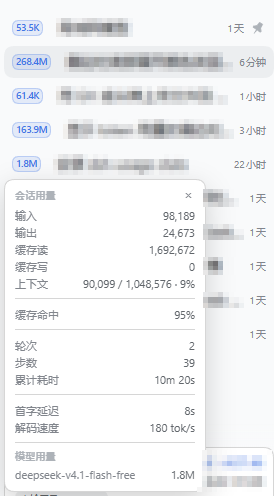
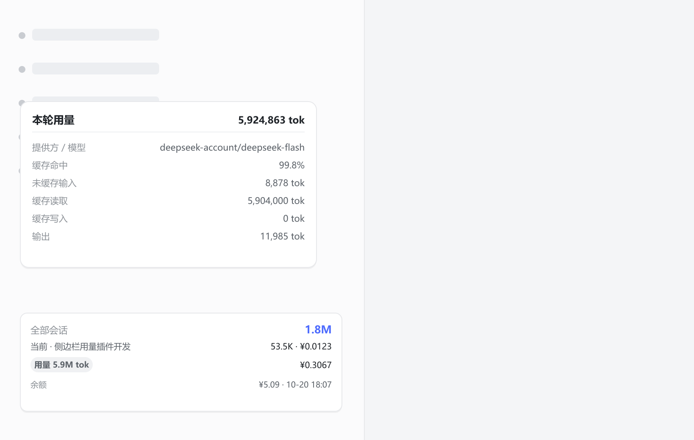
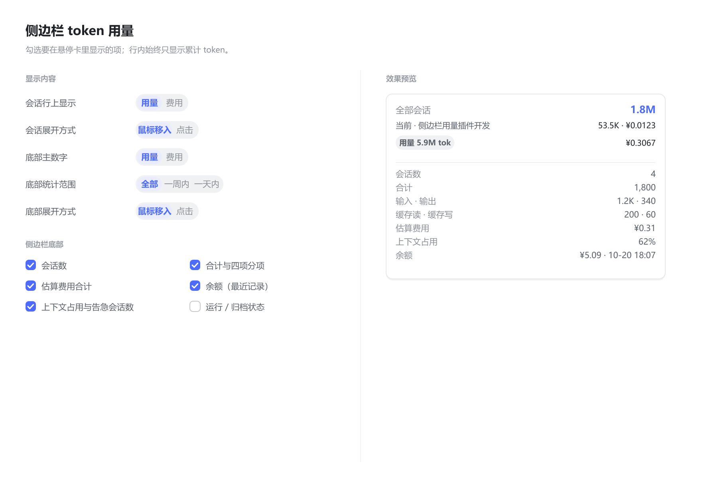

# dsh-sidebar-token-usage 使用说明

DSH（DeepSeek Harness）Web GUI 插件：在侧边栏显示每个会话的 token 用量与估算费用。

- 版本：0.3.0
- 适用：DSH 0.2.1-rc.2（桌面版 / Web 版）
- 插件目录：本仓库根目录（安装时填它的绝对路径）
- 宿主形状：宿主半边（`lib/index.js`）+ 浏览器半边（`lib/client.js`）

---

## 一、安装与生效

### 安装

侧边栏 →「插件」→「添加插件」旁小箭头 →「安装第三方插件」→ 填入**插件目录的绝对路径** → 安装。

装好后 profile（`~/.dsh/profiles/desktop`）里会多出：

- `package.json` 的 `dependencies` 一条 `link:` 指向插件目录
- `dsh.profile.bundles` 一条

因为用的是 `link:`（符号链接），**改插件源码后不需要重装**，重启 DSH 即可。

### 生效

| 改了什么 | 需要做什么 |
| --- | --- |
| 只改样式、组件、设置项 | 重启 DSH；至少 `Ctrl+Shift+R` 硬刷新 |
| 改了宿主半边（`lib/index.js`） | **必须重启 DSH**（宿主代码只在启动时加载） |

### 卸载

插件页 →「已安装插件」→ 移除。不会影响 profile 里其它插件。

---

## 二、界面构成

插件在六处出现，全部按需启用：

| 位置 | 槽位 | 说明 |
| --- | --- | --- |
| **会话行内胶囊** | `sidebar.session.row.leading` | 每个会话行最左侧，显示用量或费用 |
| **会话悬停卡** | `sidebar.session.row.hover` | 鼠标悬停会话行时展开明细 |
| **点击浮层** | `shell.overlay` | 点行内胶囊弹出，复用悬停卡同一套内容 |
| **侧边栏底部卡片** | `sidebar.footer.action` | 会话列表下方的合计卡片 |
| **本轮用量明细** | `shell.overlay` | 点底部「用量」胶囊弹出的分项卡 |
| **设置页区块** | `settings.section` | 本插件的全部配置 + 实时预览 |

### 会话行内胶囊

- 显示内容可选：**用量**（如 `53.5K`）或 **费用**（如 `¥0.0123`）
- 蓝色圆角胶囊，配色取 DSH 主题的 business 主色，深浅主题自动跟随
- 可选叠加**上下文圆环**（占用 ≥80% 转为告警色）
- 点击胶囊 → 弹出该会话的明细浮层
- 数值缺失时显示 `—`（灰色描边），不显示 `0`

> **已知问题**：胶囊可能与会话标题重叠，见「七、已知问题」。

### 悬停卡

按设置勾选渲染若干分组，默认显示：

- 输入 / 输出 / 缓存读 / 缓存写 / 上下文占用
- 当前模型与思考强度
- 估算费用
- 按模型用量（按需向宿主请求）



### 底部卡片

- 未展开时四行：
  - 第一行：全部会话（或所选时间范围内）的**用量**或**费用**
  - 第二行：**当前会话**——标题 + 该会话自己的用量，能算出费用时再跟一个 `· ¥`
  - 第三行：**最新一轮（Turn）**——左侧一颗「用量 6.1M tok」小胶囊，右侧是这一轮的价格 `¥0.3067`；
    点胶囊会在上方弹出明细卡：本轮用量、提供方 / 模型、缓存命中率、未缓存输入、缓存读取、缓存写入、输出
  - 第四行：**余额**（最近记录，非实时）——`¥5.09 · 10-20 18:07`；由「余额（最近记录）」勾选项控制，
    展开明细时自动隐藏（明细里已有同一行），折叠成 56px 轨道时也不显示
- 第三行与聊天里每条回复末尾的「本轮用量」**同一口径**：把这一轮里所有模型调用的用量加总，
  不是只取最后一次调用；因此两边数字应当一致，以此为准
- 会话里还没有走完一轮（没有 `turn/end`）时显示上一轮；老日志没有轮次边界时退回最后一次结算
- 最新一轮的胶囊与价格始终单行；读不到历史沟通时整行不显示
- 第一行的标签跟着「底部统计范围」变：全部会话 / 一周内会话 / 一天内会话
- 「当前会话」取主视图持有的那条；宿主的上报有延迟时退回最近有活动的那条
- 按「底部展开方式」展开明细：鼠标移入（默认）或点击主行开合
- 明细顶部三个范围标签 + 若干分组，标签与设置里的分段控件是同一个设置
- 折叠成 56px 轨道时自动切紧凑态（当前会话行与明细都不展开）



---

## 三、设置项

设置页结构：**左选项、右预览**，分「会话悬停卡」「侧边栏底部」两块，各自紧挨预览。窄屏（≤720px）自动单列。

预览渲染的是组件本体，改选项即时变化，在预览上点范围标签也会真的写进设置。



### 1. 单选（分段控件）

| 选项 | 取值 | 默认 |
| --- | --- | --- |
| 会话行上显示 | 用量 / 费用 | 用量 |
| 会话展开方式 | 鼠标移入 / 点击 | 鼠标移入 |
| 底部主数字显示 | 用量 / 费用 | 用量 |
| 底部统计范围 | 全部 / 一周内 / 一天内 | 全部 |
| 底部展开方式 | 鼠标移入 / 点击 | 鼠标移入 |

**展开方式**决定明细怎么出来：

- **鼠标移入**：悬停即展开（原来的行为）；会话行点胶囊仍可打开点击浮层。
- **点击**：鼠标移入不再展开。底部卡片点主行开合；会话行改由点胶囊打开浮层（`shell.overlay`），悬停卡不再重复渲染一份明细，也不会因此去请求宿主。

**底部范围**与卡片上的三个标签是**同一个设置**：点标签会写进配置，改配置标签也会跟着跳。

### 2. 悬停卡分组（10 项）

| 分组 | 默认 |
| --- | --- |
| 输入 / 输出 / 缓存明细 | 开 |
| 上下文占用 | 开 |
| 当前模型与思考强度 | 开 |
| 按模型用量（含估算费用） | 开 |
| 估算费用（仅 DeepSeek 路由） | 开 |
| 缓存命中率 | 关 |
| 轮次 / 步数 / 耗时 | 关 |
| 首字延迟 / 解码速度 | 关 |
| 权限 / 预设 / 工作目录 | 关 |
| 行内显示上下文圆环 | 关 |

### 3. 底部卡片分组（15 项）

| 分组 | 默认 |
| --- | --- |
| 会话数 | 开 |
| 合计与四项分项 | 开 |
| 估算费用合计 | 开 |
| 余额（最近记录，非实时） | 开 |
| 上下文占用与告急会话数 | 开 |
| 运行 / 归档状态 | 关 |
| 总轮次 / 步数 / 耗时 | 关 |
| 平均首字 / 解码速度 | 关 |
| 缓存命中率（全部） | 关 |
| 当前模型分布 | 关 |
| 最贵的三个会话 | 关 |
| 均每会话用量与输出占比 | 关 |
| 活动时间跨度 | 关 |
| Agent 预设与权限分布 | 关 |
| 底部显示上下文圆环 | 关 |

### 4. 价格表

设置页底部，12 个数字框：**flash / v4-pro** 两行 × **缓存命中 / 输入未命中 / 输出** 三列 × **闲时 / 高峰** 两档（CNY / 百万 token）。

预填的是 DeepSeek 官方价目表：

| | 缓存命中 | 输入未命中 | 输出 |
| --- | --- | --- | --- |
| flash 闲时 / 高峰 | 0.02 / 0.04 | 1 / 2 | 4 / 8 |
| v4-pro 闲时 / 高峰 | 0.15 / 0.3 | 4.5 / 9 | 13.5 / 27 |

下方「计价路由」文本框（逗号分隔），默认 `deepseek-account, deepseek-official, llm-deepseek`。

改完即时生效，所有费用显示立刻按新价重算。

### 5. 配置存储位置

| 内容 | 位置 |
| --- | --- |
| 勾选项与单选项 | 浏览器 `localStorage`，键 `dsh-sidebar-token-usage:fields` |
| 价格表 | 浏览器 `localStorage`，键 `dsh-sidebar-token-usage:prices` |

逐浏览器生效，不跨设备同步。

---

## 四、数据来源与口径

### 会话级数据（零成本，纯前端投影）

来自 `ctx.sessions.list` 每条会话的 `projectionValues`：

| 字段 | 用途 |
| --- | --- |
| `tokenUsage` | `{ uncachedInputTokens, outputTokens, cacheReadTokens, cacheWriteTokens }`，全日志累计 |
| `contextPressure` | `{ pressureTokens, projectedTokens, contextWindow }` |
| `sessionStats` | `{ turns, steps, llmMs, toolMs, ttftMs, ttftSteps, decodeTokens, decodeMs }` |
| `modelSelection` | `lastUsed: { provider, model, reasoningEffort }` |
| `permissions.preset` / `agentPreset` | 权限档位与 Agent 预设 |

会话总量 = 四个 bucket 之和。

### 按模型用量与最新一轮（按需，需宿主）

`tokenUsage` 只有整条会话合计，**没有模型维度、也没有单轮的用量**，两者都由宿主按需读取同一份日志：

- 路由：`GET /api/sidebar-token-usage/models?session=<id>`（按模型）、`GET /api/sidebar-token-usage/latest?session=<id>`（最新一轮）
- 触发：按模型**只有悬停卡/浮层打开时**才请求；最新一轮只针对当前会话，切走、它自己的用量变化或其运行状态变化时重新读一次
- 实现：`ctx.sessionQuery.readSession(id)`，折 `assistant/message` 的 `message.source.{provider,model}` 与 `data.usage`；
  最新一轮按最后一个 `turn/end` 找到该轮，把这一轮所有 `assistant/message` 加总，并给出按路由的拆分（混合模型也能分别计价）
- 缓存：两者共用进程内缓存（30 秒 TTL，最多 64 条会话）；`latest` 强制新鲜读，一轮结束后立刻反映

### 时间范围（重要口径）

三个范围标签按**会话最后活动时间**（列表里的 `updatedAt`）筛选会话，再对这些会话的累计值求和。

即「一周内」= 最近 7 天有过活动的那些会话，**不是**「过去 7 天消耗掉的 token」。

真正的按天消耗需要扫描全部会话日志并按事件时间切分，那是另一量级的开销，本插件刻意不做。

### 缓存命中率

`cacheReadTokens / (cacheReadTokens + uncachedInputTokens + cacheWriteTokens)`

---

## 五、费用

### 计价公式

```
(缓存读 × cacheHit + (输入 + 缓存写) × inputMiss + 输出 × output) / 1e6
```

- 高峰时段：北京时间**工作日** 09:00–12:00、14:00–18:00
- `v4-pro` 在 2026-09-14 12:00 (+08:00) 之后并入 flash 档计费

### 只对白名单路由计价

只有 `deepseek-account` / `deepseek-official` / `llm-deepseek` 出价。
`our-free-model` 这类免费或第三方路由**不显示费用**——不显示 `¥0`，也不显示占位符，那一行直接不出现。

### 三个诚实的局限

1. **节假日未建模**：法定假日里的工作日会按高峰价算，估算**偏高**而非偏低
2. **会话级费用是近似的**：按该会话「最后使用」的路由计价；中途换过模型的会话不准。「按模型用量」那一栏则是逐模型精确的
3. **不是账单**：按 token 数 × 价目表推算，真实扣费以账户为准

### 校验记录

用本机账本 2026-10-20 的 `deepseek-flash` 实收核对：

```
账本实收        2.249874
公式·全空闲     1.129110
公式·全高峰     2.258219   ← 与实收相差 0.008（0.37%）
```

---

## 六、余额

**当前是快照，不是实时查询。**

- 来源：本机 `~/.dsh/.dshw-usage.json`（另一个插件写下的最近记录），路由 `GET /api/sidebar-token-usage/balance`
- 本机记录：`5.088495 CNY`，时间 `2026-10-20 18:07`
- 卡片上会带上这个时间，标明它不是实时值
- 没有实时通道：账户是登录态，而 DeepSeek 余额接口需要 API Key；已装的 `@linxin666/dsh-usage` 有余额探测能力但处于 `disabled: true`

想要实时余额，两条路：启用 `@linxin666/dsh-usage`，或配置 DeepSeek API Key。

---

## 七、已知问题

### 会话行内胶囊与标题重叠（未解决）

**现象**：胶囊溢出画在会话标题上，数字后缀 `K`/`M` 被标题盖住。

**原因**：DSH 给该槽位写死了 `width:16px`。插件曾尝试三种方式撑开均未生效：

1. `[class*="_slot"]:has(> .stu-inline){width:auto}` —— 依赖 `:has()` + 哈希类名，实测不生效
2. 还原默认 DOM 为单元素 —— 结构正确但宽度规则仍不生效
3. 行内样式直接改 `parentElement` —— 父元素可能不是那个槽位

**当前状态**：已加入**诊断通道**，等待真实 DOM 数据。

胶囊挂载时会把祖先链（标签名、类名、行内样式、计算宽度）POST 到：

```
GET /api/sidebar-token-usage/diag?data=<json>
→ 写入 `%USERPROFILE%\.dsh\sidebar-token-usage-diag.json`
```

拿到该文件即可确定：父元素到底是谁、宽度是多少、行内样式有没有写上去。

同时保留兜底逻辑：向上逐层检查祖先，凡是计算宽度 ≤48px 的都放开宽度，直到遇到正常宽度的行容器。

### 运行中的会话看不到胶囊

DSH 既有行为：会话运行中，行首位置被状态点占用，`row.leading` 槽位不渲染。

---

## 八、开发

### 目录结构

```
package.json          # type=module, main/exports, dsh.bundle.patch, dsh.client.inject
cordis.patch.yml      # 顶层数组，插入 id: sidebar-token-usage 的插件行
lib/index.js          # 宿主半边：三条只读路由
lib/client.js         # 浏览器半边：Module Loader 工厂格式，只 require("react")
scripts/selfcheck.cjs # 无依赖自测
使用说明.md            # 本文档
README.md             # 开发向说明
```

浏览器半边必须由 Module Loader 以 `window.__ModuleLoader__.load({ id, factory })` 装载，因此 `lib/client.js`
是脚本而不是 ESM 模块；`node --check` 不适用。

### 宿主路由

| 路由 | 方法 | 用途 |
| --- | --- | --- |
| `/api/sidebar-token-usage/models?session=<id>` | GET | 单会话按模型用量 |
| `/api/sidebar-token-usage/latest?session=<id>` | GET | 单会话最新一轮的用量 |
| `/api/sidebar-token-usage/balance` | GET | 最近记录余额 |
| `/api/sidebar-token-usage/diag?data=<json>` | GET | 写入布局诊断文件 |

### 槽位契约（踩过的坑）

- `hooks` 的值必须是**可观察源**（有 `getSnapshot()` / `subscribe()` 的对象），**不能传函数**。
  传函数会被当作「延迟工厂」在组件外调用，导致 React Hook 在渲染外执行、整个槽位崩溃。
- 注册时必须带 `locale`，组件才会收到 `t` 翻译函数。
- `shell.overlay` 是 list 槽位，可注册多个。

### 自测

```bash
node scripts/selfcheck.cjs
```

以假的 `window.__ModuleLoader__`、假 `react`、假客户端 `ctx` 装载 `lib/client.js`，覆盖：

- 槽位注册与 `hooks` 契约（源必须是对象且带 `getSnapshot`/`subscribe`）
- 数字格式化 15 项边界表（含 `999950 → 1M` 这类进位边界）
- 三处组件的渲染、缺口值、折叠态
- 设置项默认值向量（26 个勾选 + 3 个单选）
- 改价 → 费用翻倍；改计价路由 → 费用消失
- 范围标签与分段控件同一设置
- 底部各分组真实数值
- 宿主三条路由与按模型聚合
- 布局诊断的祖先释放逻辑（两层窄祖先被放开、行容器不被误伤）

失败以非 0 退出。

---

## 九、文件清单

| 文件 | 说明 |
| --- | --- |
| `package.json` | 插件清单 |
| `cordis.patch.yml` | profile patch 行 |
| `lib/index.js` | 宿主半边 |
| `lib/client.js` | 浏览器半边 |
| `scripts/selfcheck.cjs` | 自测 |
| `README.md` | 开发向文档 |
| `使用说明.md` | 本文档 |
